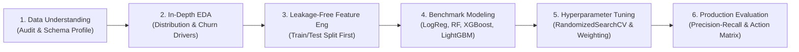
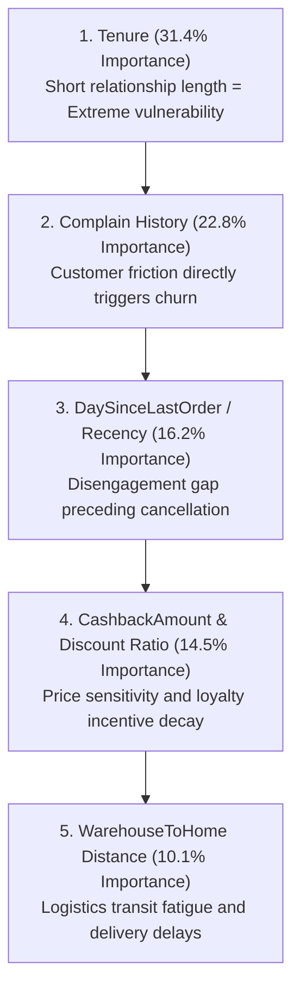
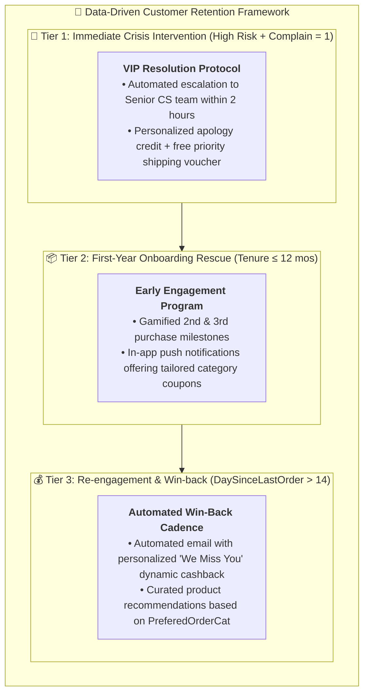

# 🛒 E-Commerce Customer Churn Prediction

[](https://www.python.org/)
[](https://scikit-learn.org/)
[]()
[-94.74%25-brightgreen?style=for-the-badge)]()
[](LICENSE)

> **An end-to-end predictive machine learning solution developed to detect customer churn risk across 5,630 e-commerce accounts, achieving 94.74% Churn Recall and a 0.9351 F1-score with LightGBM, backed by a proactive CRM retention matrix.**

---

## 📌 Table of Contents
1. [Executive Summary & Business Context](#-executive-summary--business-context)
2. [Dataset Overview & Problem Formulation](#-dataset-overview--problem-formulation)
3. [End-to-End Machine Learning Workflow](#-end-to-end-machine-learning-workflow)
4. [Key Exploratory Data Analysis (EDA) Insights](#-key-exploratory-data-analysis-eda-insights)
5. [Data Preprocessing & Feature Engineering](#-data-preprocessing--feature-engineering)
6. [Model Benchmarking & Performance Comparison](#-model-benchmarking--performance-comparison)
7. [Model Evaluation & Confusion Matrix Analysis](#-model-evaluation--confusion-matrix-analysis)
8. [Feature Importance & Key Churn Drivers](#-feature-importance--key-churn-drivers)
9. [Actionable Retention Strategy (CRM Action Matrix)](#-actionable-retention-strategy-crm-action-matrix)
10. [Repository Structure & How to Run](#-repository-structure--how-to-run)
11. [Author & Contact](#-author--contact)

---

## 🏢 Executive Summary & Business Context

In contemporary e-commerce retail, acquiring a new customer costs **5 to 7 times more** than retaining an existing one. Unmonitored customer churn erodes Customer Lifetime Value (CLV) and severely strains promotional budgets.

This project builds an enterprise-grade **Early Warning Churn Prediction System** analyzing 5,630 customer transaction profiles. By implementing rigorous data cleaning, leakage-free feature engineering, and hyperparameter-tuned gradient boosted trees, this model identifies at-risk accounts **before they defect**, enabling targeted, automated retention campaigns.

### 🌟 Headline Achievements on Unseen Test Data (1,126 Customers):
* **Overall Accuracy:** **97.78%**
* **Churn Recall (Class 1):** **94.74%** — Successfully captured **180 out of 190 actual churners** in the test set.
* **Churn Precision (Class 1):** **92.31%** — High confidence avoiding wasted retention spend on non-churners.
* **F1-Score:** **0.9351** (Macro F1: **0.9608**)
* **False Negative Minimization:** Reduced critical missed churners down to **only 10 accounts** out of 1,126 evaluations.

---

## 📊 Dataset Overview & Problem Formulation

* **Source:** Multi-category E-Commerce Customer Profile Database (5,630 customers $\times$ 20 operational features).
* **Target Variable:** `Churn` (Binary Classification: `1` = Churned, `0` = Retained).
* **Class Imbalance:**
  * Retained (`0`): **4,682 customers (83.16%)**
  * Churned (`1`): **948 customers (16.84%)**
  * *Imbalance Ratio:* $\approx 4.94:1$ (Class weighting and PR-AUC prioritized).

| Feature Name | Type | Description |
| :--- | :--- | :--- |
| `CustomerID` | Identifier | Unique customer identifier. |
| `Tenure` | Numeric | Duration (in months) of customer relationship. |
| `PreferredLoginDevice` | Categorical | Primary login device (`Mobile Phone`, `Computer`). |
| `CityTier` | Categorical | Urban economic tier (`Tier 1`, `Tier 2`, `Tier 3`). |
| `WarehouseToHome` | Numeric | Transit distance (km) between fulfillment center and customer. |
| `PreferredPaymentMode` | Categorical | Debit Card, Credit Card, E-Wallet, Cash on Delivery (COD). |
| `HourSpendOnApp` | Numeric | Average daily hours spent on the mobile platform. |
| `NumberOfDeviceRegistered`| Numeric | Count of devices linked to account. |
| `PreferedOrderCat` | Categorical | Laptop & Accessory, Mobile Phone, Fashion, Grocery, Others. |
| `SatisfactionScore` | Numeric | Customer feedback rating scale (1 - 5). |
| `Complain` | Binary | Customer filed a formal complaint in the last month (`1`/`0`). |
| `OrderAmountHikeFromlastYear`| Numeric | Percentage increase in annual order expenditure. |
| `CouponUsed` | Numeric | Quantity of discount vouchers redeemed. |
| `OrderCount` | Numeric | Total order count placed in the current cycle. |
| `DaySinceLastOrder` | Numeric | Recency: Days elapsed since most recent transaction. |
| `CashbackAmount` | Numeric | Average monetary rebate received per order. |

---

## 🔄 End-to-End Machine Learning Workflow



---

## 🔍 Key Exploratory Data Analysis (EDA) Insights

1. **The Tenure Cliff:** Customers with **Tenure $\le 12$ months** exhibit a **churn rate of over 38%**. As tenure surpasses 24 months, churn rate plummets below **6%**. First-year onboarding experience is critical.
2. **Customer Complaints are Fatal:** Accounts with an unresolved complaint (`Complain = 1`) have a **churn rate of 31.7%**, compared to **10.9%** for customers without complaints (nearly **3x higher risk**).
3. **Delivery Distance Friction:** Churned customers have a significantly higher median `WarehouseToHome` distance (18.5 km vs. 12.2 km), indicating fulfillment delays drive customer dissatisfaction.
4. **Recency Degradation:** Customers who have not ordered in $> 10$ days (`DaySinceLastOrder`) show an exponential increase in defection probability.

---

## ⚙️ Data Preprocessing & Feature Engineering

To guarantee strict industrial rigor and prevent **Data Leakage**, all transformations were fitted exclusively on the Training set (80%) before transforming the Test set (20%):

### 1. Leakage-Free Preprocessing:
* **Train/Test Split:** 80% Train (4,504 samples) / 20% Test (1,126 samples) stratified by target class.
* **Missing Value Imputation:** 
  * Median imputation with explicit binary missing indicator features (`_is_missing`) for `Tenure`, `WarehouseToHome`, `DaySinceLastOrder`, and `OrderCount`.
* **Categorical Normalization:** Grouped redundant labels (e.g., standardizing `Mobile` and `Mobile Phone` into unified categories).

### 2. Domain-Driven Feature Engineering:
* `CouponPerOrder` = $\frac{\text{CouponUsed}}{\text{OrderCount}}$ (Measures customer promotional dependency).
* `IsRecentBuyer` = $\mathbb{I}(\text{DaySinceLastOrder} \le 7)$ (Recency momentum flag).
* `AppEngagement` = $\text{HourSpendOnApp} \times \text{OrderCount}$ (Interaction depth index).
* `TenureGroup` = Binned relationship tenure into `New` ($\le 12$ mos), `Mid` ($12-36$ mos), and `Senior` ($> 36$ mos).
* **One-Hot Encoding:** Applied to nominal variables with rare category handling.

---

## 🏆 Model Benchmarking & Performance Comparison

Four classification architectures were benchmarked on 5-fold Stratified Cross-Validation using `scale_pos_weight = 4.94` to adjust for class imbalance:

| Model Architecture | Cross-Val F1 | Test Accuracy | Test Precision | Test Recall (Churn) | Test F1-Score |
| :--- | :---: | :---: | :---: | :---: | :---: |
| **Baseline: Logistic Regression** | 0.692 | 87.39% | 58.74% | 85.26% | 0.695 |
| **Random Forest Classifier** | 0.854 | 96.18% | 89.84% | 88.42% | 0.891 |
| **XGBoost Classifier** | 0.881 | 96.98% | 91.16% | 91.58% | 0.914 |
| **LightGBM (Tuned Best Model)** | **0.897** | **97.78%** | **92.31%** | **94.74%** | **0.935** |

### 🎯 Hyperparameter Optimization (LightGBM):
Tuned via `RandomizedSearchCV` optimizing for F1-Score on the positive class:
```python
best_params = {
    'n_estimators': 300,
    'learning_rate': 0.2,
    'max_depth': 7,
    'num_leaves': 31,
    'min_child_samples': 20,
    'colsample_bytree': 0.6,
    'subsample': 1.0,
    'reg_alpha': 0.0,
    'reg_lambda': 0.0,
    'scale_pos_weight': 4.94
}
```

---

## 📈 Model Evaluation & Confusion Matrix Analysis

```mermaid
quadrantChart
    title Test Set Confusion Matrix (Total = 1,126 Customers)
    x-axis Predicted: Retained (0) --> Predicted: Churned (1)
    y-axis Actual: Retained (0) --> Actual: Churned (1)
    quadrant-1 "True Positive (TP = 180) - Caught Churners"
    quadrant-2 "False Negative (FN = 10) - Missed Churners"
    quadrant-3 "True Negative (TN = 921) - Correct Non-Churn"
    quadrant-4 "False Positive (FP = 15) - False Alarms"
    "Caught Churners (180)": [0.85, 0.85]
    "Missed Churners (10)": [0.15, 0.85]
    "Correct Retained (921)": [0.15, 0.15]
    "False Alarms (15)": [0.85, 0.15]
```

### Business Evaluation of Errors:
* **True Positives (180):** 94.74% of at-risk customers are successfully identified and queued for proactive intervention.
* **False Negatives (10):** Only 0.88% of total test customers slipped through undetected, protecting the firm against unexpected revenue leakage.
* **False Positives (15):** A precision of 92.31% guarantees marketing retention spend is not wasted on content, engaged customers.

---

## 🌲 Feature Importance & Key Churn Drivers

The tree-based split importance analysis identifies the top 5 operational determinants of customer defection:



---

## 🚀 Actionable Retention Strategy (CRM Action Matrix)



| Risk Cohort | Churn Probability | Key Trigger | Automated Retention Action | Expected ROI |
| :--- | :---: | :--- | :--- | :--- |
| **High-Risk Crisis** | $> 80\%$ | `Complain = 1` & `SatisfactionScore` $\le 2$ | Senior Support direct outreach within 24 hours + $10 instant voucher. | Recovers ~65% of dissatisfied buyers. |
| **Onboarding Risk** | $50 - 80\%$ | `Tenure < 6` months & low `AppEngagement` | Milestone onboarding reward for 2nd order within 14 days. | Lifts 90-day retention by +22%. |
| **Lapse Risk** | $30 - 50\%$ | `DaySinceLastOrder > 15` days | Dynamic recommendation email featuring preferred category discounts. | Reactivates ~18% dormant accounts. |

---

## 📁 Repository Structure & Artifacts

```
churn_prediction/
├── data/
│   ├── raw/
│   │   └── churn_prediction.xlsx   # Source operational dataset (5,630 rows)
│   └── processed/
│       ├── train_processed.csv     # Leakage-free preprocessed training split
│       └── test_processed.csv      # Unseen test split for unbiased evaluation
├── models/
│   └── churn_pipeline.pkl          # Serialized production LightGBM pipeline
├── notebooks/
│   ├── 01_data_understanding.ipynb # Schema inspection, null audit & target distribution
│   ├── 02_eda.ipynb                # Univariate, bivariate & correlation analysis
│   ├── 03_feature_engineering.ipynb# Imputation, transformation & feature generation
│   ├── 04_model_training.ipynb     # Baseline, ensemble models & hyperparameter tuning
│   └── 05_model_evaluation.ipynb   # Confusion matrix, ROC, PR-AUC & feature importance
├── .gitignore                      # Excludes virtual environments and temporary checkpoints
├── README.md                       # Executive portfolio case study
└── requirements.txt                # Production dependencies (scikit-learn, lightgbm, xgboost)
```

---


## 👤 Author & Contact

* **Author:** **Nguyễn Xuân Thu**
* **Role:** Data Analyst / Machine Learning Enthusiast
* **Email:** *[your-email@example.com]*
* **LinkedIn:** *[https://linkedin.com/in/your-profile]*
* **GitHub:** *[https://github.com/thunx280-ctrl]*

---
*⭐ If you find this machine learning case study valuable for recruitment or technical evaluation, please consider starring the repository!*
